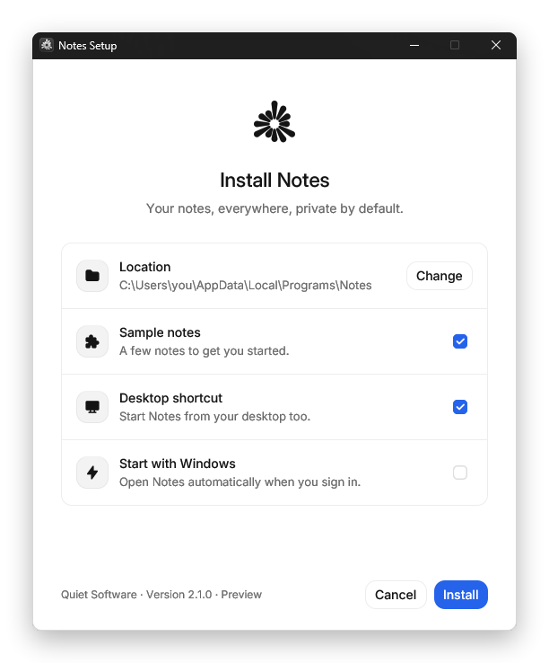
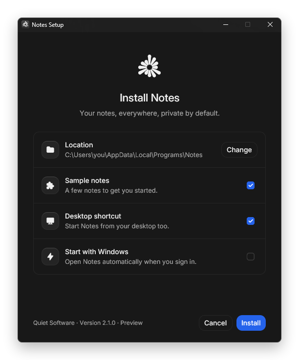

<p align="center">
  
</p>

<h1 align="center">Bach</h1>

<p align="center">
  <strong>One <code>bach.toml</code> in, one <code>Setup.exe</code> out.</strong><br>
  Windows installers with a native window, in-place updates and a clean uninstaller,<br>
  without an installer script and without an administrator prompt.
</p>

<p align="center">
  <a href="docs/getting-started.md">Getting started</a> ·
  <a href="docs/config.md">Config reference</a> ·
  <a href="https://github.com/usebach/bach/releases">Releases</a> ·
  <a href="LICENSE">MIT license</a>
</p>

Bach packs the folder your app builds into, plus a short config file, into a
single setup file. Your users get one calm window in their own language; you
get updates over older installs and an uninstaller in **Settings › Apps**
without writing installer logic.

<p align="center">
  
  
</p>

## Quick start

Install the `bach` command. No Rust needed, no administrator rights:

```bash
# Windows, macOS and Linux (Node.js 18 or newer)
npm install --global @usebach/cli
```

No Node.js? One line does it too, and it works the same in CI:

```powershell
# Windows (PowerShell): installs to %LOCALAPPDATA%\Programs\bach-cli and adds it to PATH
irm https://raw.githubusercontent.com/usebach/bach/main/install.ps1 | iex
```

```bash
# macOS or Linux, for building Windows installers in CI
curl -fsSL https://raw.githubusercontent.com/usebach/bach/main/install.sh | sh
```

Then, in your project:

```bash
bach init      # writes a commented bach.toml (and, on GitHub, a release workflow)
bach check     # validates it and lists every file the installer will carry
bach preview   # opens the real window; nothing is installed
bach build     # writes the setup file
```

In a GitHub repository, `bach init` also adds a one-click release: commit it,
then press **Actions › Release › Run workflow**. See [releasing](docs/releasing.md).

A complete config, for a Rust app:

```toml
[app]
name = "Hello"
version = "1.0.0"
publisher = "Hello Inc."
executable = "hello.exe"

[files]
source = "target/release"
exclude = ["*.pdb", "deps/**", "build/**"]
```

```console
$ bach build
Wrote dist\Hello-Setup-1.0.0.exe (9.7 MB)
  Packed       101.8 KB of 216.5 KB (47%), in 0.9s
```

[examples/hello](examples/hello) is a working project to try it on, and
[getting started](docs/getting-started.md) walks through it step by step.

## Why Bach

[NSIS](https://nsis.sourceforge.io), [Inno Setup](https://jrsoftware.org/isinfo.php)
and [WiX](https://wixtoolset.org) can build almost any installer, and ask you
to learn a scripting language or an XML schema to do it. Bach covers the common
case, an app that installs for one user, with settings instead of code:

- **No script.** Everything is a setting in one TOML file with an
  [editor schema](schema/bach.schema.json). Every mistake is reported as one
  sentence naming the setting at fault.
- **No admin prompt unless you want one.** Apps install per user into
  `%LOCALAPPDATA%\Programs` and only write to the user's own folders and
  `HKCU`. For every user of a computer, `scope = "machine"` installs into
  `%ProgramFiles%` after one Windows prompt.
- **Updates that can't half-fail.** A newer setup file updates an install in
  place: files are unpacked first and swapped in together, and if one is
  locked, everything is put back. Files the new version no longer ships are
  removed.
- **A window people can read.** 19 languages built in, following the Windows
  display language; light and dark mode; every text replaceable.
- **Builds anywhere.** `bach` runs on Windows, macOS and Linux, so installers
  can come out of any CI. Setup files need no .NET and no Visual C++ runtime.

**Use something else when** you need an MSI for Group Policy deployment,
Windows services or drivers, custom install-time scripts, binary diffs inside
a file for updates ([Velopack](https://velopack.io) does those; Bach's patches
work on whole files), or a small stub: a Bach setup file adds about 10 MB to
your app.

## What setup files can do

| | |
| --- | --- |
| **Choices** | Desktop and Start menu shortcuts, start with Windows, add to `PATH`, each offered ticked, unticked, always or never; optional components |
| **Integration** | `myapp://` link schemes and file types, never taking over another app's |
| **Look and words** | 14 built-in styles (soft gradients, terminal, game looks, ...) and your own fonts, colours, corners and background picture; 10 layout presets and your own layout: window size, portrait or landscape, a picture panel or banner, a floating card, tiles, alignment, spacing, button placement and page animation; your logo and icon; light, dark or system theme; any text, per language; a license page |
| **Safety** | Free-space check, archive checksum, one setup per app at a time, "close and continue" when the app is open, data deleted only on request |
| **Automation** | `Setup.exe /S` with `--dir`, `--with`, `--without`, `--log`; quiet uninstall from Settings › Apps |
| **Online and private** | An online installer that always downloads the newest version; access keys that encrypt the files and keep updates private: see [config](docs/config.md#installer) |
| **Updates** | Over older installs always; by themselves in the background from GitHub releases (or any https feed), installed when the app is closed, undone cleanly if a power cut interrupts them: see [updates](docs/updates.md) |

Every setting is in the [config reference](docs/config.md).

## Commands

| Command | What it does |
| --- | --- |
| `bach init` | Writes a starter `bach.toml`; fills it in for Rust, Tauri, Electron, .NET, Godot and Unity projects. In a GitHub checkout it also writes the release workflow (`--no-workflow` skips that). |
| `bach workflow` | Adds, or updates, the one-click release workflow in `.github/workflows/bach-release.yml`; `--winget ID` also opens the winget-pkgs update pull request after each release. See [releasing](docs/releasing.md). |
| `bach version [patch\|minor\|major\|X.Y.Z]` | Lists the version in every file that has one, or raises it in all of them at once: `bach.toml`, `package.json` and its lock file, `Cargo.toml` and `Cargo.lock`, Tauri's config, `.csproj`. |
| `bach check` | Validates the config and lists every file and option, with warnings. `--strict` (or `BACH_STRICT=1`) turns a warning into an error, so a pipeline can't ship what check complains about. |
| `bach preview` | Opens the window without installing; `--uninstall`, `--theme dark`, `--lang de`, `--style arcade` and `--layout showcase` (try another style or layout without changing `bach.toml`). |
| `bach watch` | Like `bach preview`, and opens the window again every time you save `bach.toml` (or a file it names: the logo, license, texts, fonts or pictures). A mistake is printed and the window stays as it was. |
| `bach build` | Writes the setup file; `--fast` compresses less, `--out` picks the path, `--app-version v1.4.0` sets the version (from a release tag), `--online` also writes the online installer, `--key-file` gives the access key, `--patch-from OLD.exe` also writes an update patch with only the files that changed, `--strict` stops before building when `bach check` would warn. |
| `bach sign FILE` | Signs a setup file with the program `[signing]` names; `bach build --sign` does it for the files it writes. Optional. |
| `bach key` | Makes random access keys for an app with `[access]` (`--count N`). |
| `bach inspect FILE` | Shows what a setup file or an installed `uninstall.exe` carries. |
| `bach verify FILE` | Checks a setup file for damage without installing it: the archive and every file against the checksums recorded at build, and whether it carries a signature. `--key-file` opens an encrypted one. See [Checking a setup file](docs/config.md#checking-a-setup-file). |
| `bach diff OLD NEW` | Shows what changed between two setup files of an app: files added, removed and changed, new registry values and variables, and which files made the app bigger. See [Comparing two setup files](docs/config.md#comparing-two-setup-files). |
| `bach page FILE --url URL` | Writes a download page for a setup file: one HTML file with the name, version, size, a download button and the SHA-256 (`--notes-file`, `--winget ID`). See [A download page](docs/config.md#a-download-page). |
| `bach styles` | Lists the 14 built-in styles of the window (`installer.style`): what each looks like and what kind of app it suits. See [`[style]`](docs/config.md#style). |
| `bach layouts` | Lists the 10 built-in layouts (`[layout] preset`). See [`[layout]`](docs/config.md#layout). |
| `bach doctor` | Says whether everything a build needs is in place. |
| `bach update [VERSION]` | Updates `bach` itself to the newest release (or exactly `VERSION`). `--check` only says whether a newer release exists, `--force` installs again. A copy managed by npm, Scoop, winget or Cargo gets the command that updates it instead. See [Keeping bach up to date](#keeping-bach-up-to-date). |
| `bach feed FILE` | Writes the update feed for a (signed) setup file; the link comes from `bach.toml` (or `--url`), `--notes-file` says what's new, `--rollout 10` offers it to 10% of computers first, `--patch FILE` offers an update patch. |
| `bach winget FILE --url URL` | Writes the manifests that list a setup file in winget. |
| `bach intune FILE` | Writes what Microsoft Intune needs to deploy a setup file: the install and uninstall commands, the detection rule and a detection script. See [Deploying with Intune](docs/config.md#deploying-with-intune). |

## Keeping bach up to date

When a newer release exists on GitHub, `bach` says so at the end of a command
run in a terminal:

```text
A new version of Bach is available: 0.7.1 to 0.8.0.
Update with: bach update
```

Run `bach update` to install it. It downloads the release for your system,
checks it against the SHA-256 published next to it, and replaces `bach` (and
the `bach-setup.exe` beside it) only when everything is in order; if a step
fails, the old files are back. `bach update --check` only reports, and
`bach update 0.7.1` installs exactly that version.

Every command starts the check in the background; it never delays a command,
and a failed one (you're offline) is forgotten without a word. It is silent in CI, with `--json`, and when stderr isn't a terminal. Turn it
off with `BACH_NO_UPDATE_CHECK=1`. A `bach` that npm, Scoop, winget or Cargo
installed is theirs to update: `bach update` names the command, and the
notice shows it too.

## Other ways to install

- **npm** (`npm install --global @usebach/cli`, or `--save-dev` for one
  project and `npx bach`): update with `npm update --global @usebach/cli`,
  remove with `npm uninstall --global @usebach/cli`.
- **For every user:** the install scripts install per user and never ask for
  administrator rights. Ask for a system-wide install with
  `$env:BACH_SCOPE = 'system'` before the PowerShell line (to
  `%ProgramFiles%\bach-cli`; Windows asks for permission once, and declining
  installs it for you alone) or `sh -s -- --system` after the shell one (to
  `/usr/local/bin`, using `sudo` for that copy only).
- **Scoop:** `scoop install https://raw.githubusercontent.com/usebach/bach/main/scoop/bach.json`
- **GitHub Actions**, on any runner. Build and publish a release for every
  pushed tag like `v1.4.0` (the tag is the app's version; installed apps
  update from it, see [updates](docs/updates.md)):

  ```yaml
  permissions:
    contents: write
  steps:
    - uses: actions/checkout@v4
    # ... build your app ...
    - uses: usebach/bach@v0
      with:
        config: bach.toml
        release: true
  ```

  Or only build, and publish the file yourself:

  ```yaml
  - uses: usebach/bach@v0
    id: bach
    with:
      config: bach.toml
  - uses: actions/upload-artifact@v4
    with:
      path: ${{ steps.bach.outputs.setup }}
  ```

  `@v0` follows the newest 0.x release, `@v0.2` the newest 0.2.x, `@v0.2.1`
  never moves; the Bach version that builds follows what you pin.

- **By hand:** download `bach-<version>-windows-x64.zip` from
  [releases](https://github.com/usebach/bach/releases) and keep `bach.exe` and
  `bach-setup.exe` together.

Coding agents can learn all of this from [skills/bach/SKILL.md](skills/bach/SKILL.md)
(`npx skills add usebach/bach`).

## Build from source

With Rust (stable) and the Visual Studio C++ build tools:

```bash
git clone https://github.com/usebach/bach.git
cd bach
cargo build --release
```

That gives `target\release\bach.exe` and `target\release\bach-setup.exe`.
[How it works](docs/how-it-works.md) explains the setup file format and the
safety rules; [AGENTS.md](AGENTS.md) covers the code layout, checks and
conventions for changes.

## Contributing

Bug reports, translations and pull requests are welcome; start with
[CONTRIBUTING.md](CONTRIBUTING.md). Questions go to [SUPPORT.md](SUPPORT.md),
security problems to the [security policy](SECURITY.md), and everyone here
follows the [Code of Conduct](CODE_OF_CONDUCT.md).
